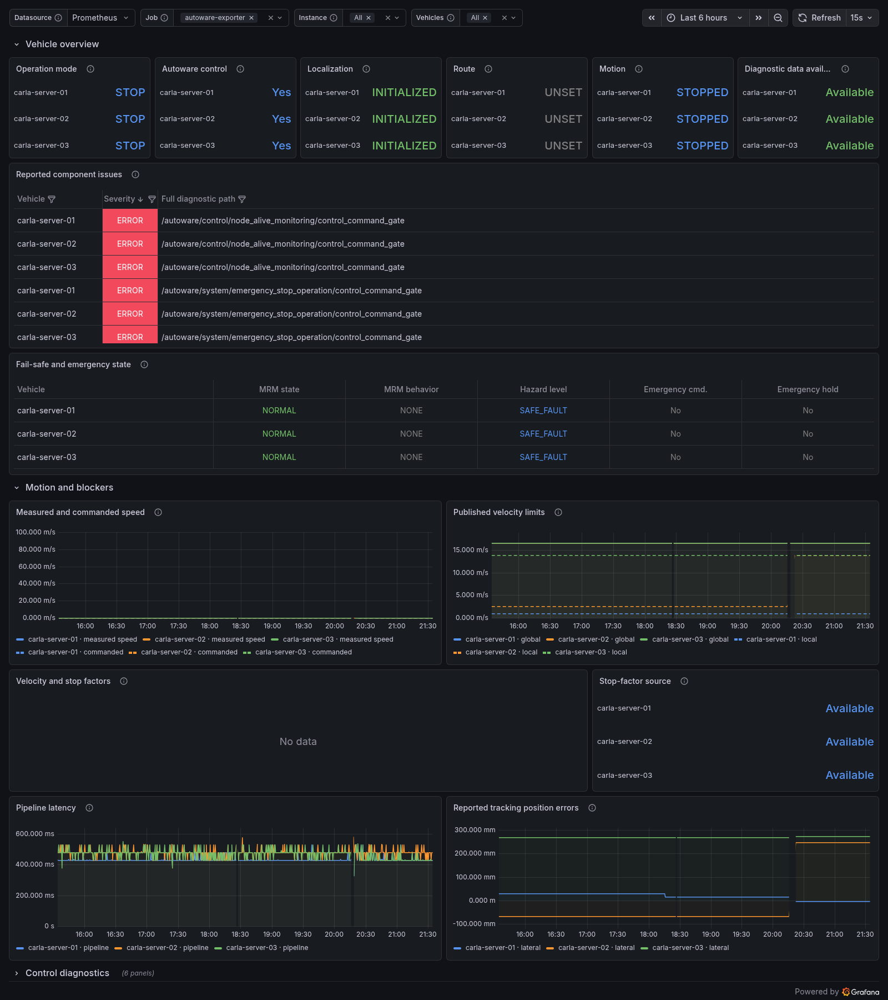

# Autoware Exporter

[](https://github.com/Adanomy/autoware-exporter/actions/workflows/ci.yml)
[](go.mod)
[](#compatibility)
[](#compatibility)
[](LICENSE)

A read-only Prometheus exporter for **Autoware**. Monitor vehicle states,
ROS 2 diagnostics, motion, and performance for multiple vehicles with a single
Go binary.

Tested with **Universe 0.51–0.53** on **ROS 2 Humble and Jazzy**. Uses native
ROS 2 C libraries through project-owned CGO bindings.

[](https://adanomy.com/)
[](https://github.com/Adanomy/autoware-exporter/releases)
[](docs/metrics.md)
[](https://grafana.com/grafana/dashboards/25976)
[](#configuration)

[](docs/images/dashboard-full.png)

## Quick start

Start the exporter against an existing Autoware deployment. Replace
`vehicle-01:0` with your vehicle name and ROS domain:

```sh
docker run -d \
  --name autoware-exporter \
  --restart unless-stopped \
  --network host \
  ghcr.io/adanomy/autoware-exporter:latest \
  --vehicle=vehicle-01:0
```

<details>
<summary>Docker Compose</summary>

For a persistent deployment, save this as `compose.yaml`:

```yaml
services:
  autoware-exporter:
    image: ghcr.io/adanomy/autoware-exporter:latest
    restart: unless-stopped
    network_mode: host
    command:
      - --vehicle=vehicle-01:0
```

```sh
docker compose up -d
```

View logs with `docker compose logs -f autoware-exporter`.

</details>

Metrics are served at [localhost:9841/metrics](http://localhost:9841/metrics).
Check exporter health at [/healthz](http://localhost:9841/healthz) and logs with
`docker logs -f autoware-exporter`. The health endpoint checks the HTTP process;
ROS context initialization is reported by `autoware_ros_context_up`, and usable
source data by `autoware_topic_data_available`.

The native runtime requires **Linux** and runs as a non-root user in the image.
Host networking is intended for Linux hosts. DDS discovery and routing must
already work between the exporter and the monitored ROS graphs. The exporter
subscribes to topics and never publishes commands, sets routes, or changes
vehicle state.

The `latest` tag follows the newest stable exporter release and selects Jazzy.
Use `latest-humble` for Humble and a version tag or image digest to keep a
deployment fixed.

Release builds use separate **Humble** and **Jazzy** artifacts for Linux
amd64/arm64. Each binary needs the matching ROS/Autoware libraries recorded in
its build metadata; it is not a standalone static executable. See
[building and releases](docs/building.md).

## Configuration

Configure the exporter with command-line flags, placed **after the image name**
in `docker run`, or in the service's `command` list in Compose. All settings have
defaults; the exporter does not read an application configuration file.

### Vehicles and sources

| Flag | Default | Description |
| --- | --- | --- |
| `--web.listen-address` | `:9841` | HTTP listen address. With host networking, this is an address on the host. |
| `--vehicle` | `default:0` | Vehicle as `name:domain[:namespace]`; repeat for multiple vehicles. |
| `--collectors` | All | Comma-separated groups: `state,vehicle,diagnostics,control,localization,perception,performance,routing,energy`. |
| `--source.max-age` | `10s` | Receive-age limit for periodic sources. Must be greater than zero and at most `1h`. |

Vehicle names become the `vehicle` label. Each target owns an independent ROS
context. For example, `--vehicle=vehicle-01:51 --vehicle=vehicle-02:52` reads
two ROS domains. A namespace prefixes source topics:
`--vehicle=vehicle-01:51:/fleet/vehicle_01` subscribes to
`/fleet/vehicle_01/api/operation_mode/state`. Domains range from 0 to 232;
duplicate vehicle names and duplicate domain/namespace targets are rejected.

Optional topics may be absent. Missing, invalid, or expired measurements remain
absent rather than becoming zero. State notifications can remain unchanged for
hours and do not expire by receive age; a lost or replaced publisher invalidates
cached state. See [metric interpretation and source topics](docs/metrics.md).

### ROS transport

| Flag | Default | Description |
| --- | --- | --- |
| `--ros.poll-interval` | `50ms` | Maximum wait per ROS receive iteration. Accepts `1ms` to `1s`. |
| `--ros.retry-interval` | `5s` | Retry interval for unavailable clients and subscriptions. Accepts `100ms` to `5m`. |

Standard ROS middleware settings, including `RMW_IMPLEMENTATION` and
`CYCLONEDDS_URI`, apply to the ROS libraries. Use a matching image and middleware
configuration for your deployment. The exporter does not create network tunnels
or bridge ROS domains.

### Logging and diagnostics

| Flag | Default | Description |
| --- | --- | --- |
| `--log.level` | `info` | Log verbosity: `debug`, `info`, `warn`, or `error`. |
| `--log.format` | `text` | Log output format: `text` or `json`. |

Logs are written to stderr. Add `--log.format=json` for structured logs or
`--log.level=debug` for troubleshooting. Print all options with
`docker run --rm ghcr.io/adanomy/autoware-exporter:latest --help`; use `--version`
to print build information and native ROS availability.

## Compatibility

| Universe branch | Tested release | Core reference | AD API message packages | ROS 2 |
| --- | --- | --- | --- | --- |
| 0.53 | 0.53.1 | 1.10.0 | 1.9.2 | Humble, Jazzy |
| 0.52 | 0.52.0 | 1.9.0 | 1.9.2 | Humble, Jazzy |
| 0.51 | 0.51.0 | 1.8.0 | 1.9.1 | Humble, Jazzy |

CI covers the current and two previous stable Universe branches. It builds
pinned upstream message definitions and checks native subscription,
introspection, and metric values in six isolated environments. Core versions
are reference context; CI does not start the full Autoware stack. See
[compatibility tests and revisions](tests/compatibility/README.md).

The matrix describes tested coverage. Production code has no Autoware version
allowlist: older, newer, and customized deployments can work with compatible
topics, message fields, and type-support libraries. Optional measurements depend
on the upstream nodes and messages available in a particular launch.

## License

[MIT](LICENSE). [Contributing](CONTRIBUTING.md) · [Security](SECURITY.md)
